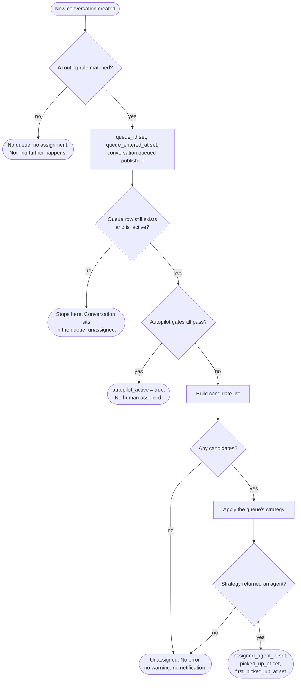

# Assignment Logic

**How Blink Engage decides which agent handles a conversation — and the
five different code paths that can change an assignment.**

Written for an administrator choosing a queue's assignment strategy, or
trying to work out why a particular agent ended up with a particular
conversation. It describes the system **as it behaves today**.

Companion documents: [queue-architecture.md](queue-architecture.md),
[routing-rules.md](routing-rules.md),
[queue-lifecycle.md](queue-lifecycle.md),
[sla-engine.md](sla-engine.md). Original design record:
[queues-routing.md](queues-routing.md) decisions #2, #5, #6, #7, #10.

---

## 1. The five ways a conversation acquires an owner

Only one of them is automatic. The other four are somebody pressing a
button.

| # | Path | Trigger | Sets `picked_up_at`? | Sets `first_picked_up_at`? | Event published |
|---|---|---|---|---|---|
| 1 | **Auto-assignment** | A new conversation is routed into an active queue whose strategy is `round_robin` or `least_load` | Yes | Yes | `conversation.assignment_changed` |
| 2 | **Manual pickup** — `POST /conversations/{id}/pick` | An agent claims a waiting conversation for themselves | Yes | Yes (once, never overwritten) | `conversation.picked` |
| 3 | **Transfer** — `POST /conversations/{id}/transfer` | A supervisor hands it to a named agent or to a department | **No** | **No** | `conversation.transferred` |
| 4 | **Direct assignment** — `PATCH /conversations/{id}` with `assigned_agent_id` | A supervisor sets the assignee; also how SLA escalation's `reassign_agent` works | **No** | **No** | `conversation.updated` + `conversation.assignment_changed` |
| 5 | **Autopilot takeover** — `DELETE /conversations/{id}/autopilot` | A human takes a conversation back from AI | Yes | Yes, if not already set | `conversation.autopilot_stopped` |

The inconsistency in columns 4 and 5 is real and it matters for reporting
— see §7.

---

## 2. Auto-assignment: when it runs

Auto-assignment happens in exactly one place: immediately after routing,
inside the conversation-ingest consumer, in the same transaction that
creates the conversation.



Auto-assignment therefore **never** runs:

- on a second or later message in a thread;
- when a conversation is reopened;
- when a conversation is moved between queues (by `PATCH`, by SLA
  escalation, or by a transfer);
- when an agent releases a conversation back to the queue;
- when a new agent comes online, or gains a skill;
- when you change a queue's strategy from `manual` to `round_robin`.

Conversations already waiting when you change a strategy **stay waiting**.
The new strategy applies only to conversations that arrive afterwards.

---

## 3. Who is a candidate

The candidate list is built in two steps.

### Step 1 — availability

Every agent in the company where:

- the agent is not deleted, **and**
- their status is **not** `offline` and **not** `busy`.

That is the entire filter. Consequences:

| Status | Auto-assignable? | Notes |
|---|---|---|
| `online` | Yes | |
| `away` | **Yes** | Counter-intuitive but deliberate: `away` is a soft signal and stays eligible, unchanged since the feature shipped |
| `busy` | No | Self-service only — the system never sets `busy` on an agent's behalf |
| `offline` | No | Set automatically when an agent's WebSocket disconnects |

The candidate list is **not** filtered by department, by team, by the
queue's department, by current workload, by working hours, or by whether
the agent has ever logged in. An agent created five minutes ago and left
at `online` is as eligible as anybody else.

### Step 2 — required skills

If the queue has one or more required skills, candidates are narrowed to
agents holding **at least one** of them (any-of, not all-of — see
[queue-architecture.md](queue-architecture.md) §4). A queue with no
required skills skips this step entirely.

If the list is empty after either step, **no assignment happens and
nothing is recorded about why.** The conversation waits.

---

## 4. The three strategies

### `manual` — the default for new queues

Never auto-assigns. Always returns nobody. The conversation waits,
visible to every eligible agent, until one of them picks it.

This is the default deliberately: creating a queue should not silently
start handing work out until somebody opts in.

### `round_robin` — fewest conversations currently attributed

Picks the candidate with the **lowest count of conversation rows that
currently name them as assignee**. That count includes:

- conversations in **every** status — open, pending, **resolved and
  closed**;
- conversations in **every** queue, and conversations with no queue at
  all;
- **soft-deleted** conversations.

It excludes only conversations that were later released or reassigned to
somebody else (because `assigned_agent_id` is the *current* assignee, not
a history).

In practice this behaves as a **lifetime workload tally**, not a rotation
cursor. See the worked example in §5 — the consequence is not what most
people expect from the name "round robin".

### `least_load` — fewest conversations open right now

Picks the candidate with the lowest count of conversations that are:

- assigned to them, **and**
- status `open` or `pending`, **and**
- not soft-deleted.

Counted **company-wide across every queue**, not per queue — the point of
load balancing is an agent's total workload, not their share of one
queue.

### Ties

Both strategies pick the minimum, and on a tie the winner is **the first
candidate in the order the database happened to return agents**. There is
no `ORDER BY` on the candidate query, so that order is not guaranteed and
not reproducible. With three idle agents all at zero, you cannot predict
or explain which one gets the next conversation.

---

## 5. Worked examples

### Example A — `least_load`, three agents

Queue `Support`, strategy `least_load`, no required skills. All three
agents `online`.

```
Agent      open+pending assigned (company-wide)
---------  --------------------------------------
Ana        7
Ben        2
Cara       2
```

A new conversation arrives → candidates {Ana, Ben, Cara} → counts
{7, 2, 2} → minimum is 2 → tie between Ben and Cara → **whichever the
database returned first** wins. Not predictable.

Ana resolves five of her seven. Her open count drops to 2, so the next
conversation is a three-way tie. Resolving work makes you eligible again
immediately under `least_load`.

### Example B — the surprise: `round_robin` and a new hire

Same queue, strategy changed to `round_robin`. Cara joined this morning.

```
Agent      conversation rows naming them as assignee
           (any status, any queue, incl. resolved/closed)
---------  -----------------------------------------------
Ana        412
Ben        389
Cara       0
```

The next conversation goes to Cara. So does the one after that. And the
one after that.

**Cara receives every single conversation until her tally reaches 389** —
the next-lowest agent's — because the count never decreases when she
resolves them. Resolving a conversation does not clear
`assigned_agent_id`, so a resolved conversation still counts towards its
agent's total forever.

This is genuinely counter-intuitive for a setting called "round robin",
and it is worth saying plainly: **`round_robin` does not rotate.** It
equalises lifetime totals. On a mature company where agents have
accumulated very different historical totals, it will concentrate all new
work on the least experienced agent — and on a brand-new company where
everyone starts at zero, it behaves roughly as you would expect, which is
why the behaviour often goes unnoticed until a new hire arrives.

If you want work spread by *current* load, use `least_load`.

### Example C — the queue nobody can work

Queue `German Support`, required skill `german`, strategy `round_robin`,
five agents online, **none of them holding `german`**.

```
Step 1 (availability):  5 candidates
Step 2 (skills):        0 candidates
Strategy:               not even consulted
Result:                 unassigned, forever
Signals raised:         none
```

The conversation sits at `waiting_count` on the Live Dashboard, its wait
time climbs, and eventually its SLA breaches. The breach is the only
notification anybody receives, and it says nothing about the skill gate
being the cause.

---

## 6. Manual pickup, release and transfer

### `POST /conversations/{id}/pick`

An agent claims a waiting conversation **for themselves**. There is no
"pick on behalf of" — the target is always the caller — which is why it
only needs the routine `conversations.pick` permission rather than the
supervisory `conversations.transfer`.

Checks performed, in order:

| # | Check | Failure |
|---|---|---|
| 1 | The conversation exists **in the caller's company** | 404 — cross-tenant callers get 404, never 403 |
| 2 | It has a `queue_id`. A conversation that never matched a routing rule **cannot be picked at all** | 400 |
| 3 | Its status is `open` or `pending`. A `resolved`/`closed` conversation cannot be picked | 400 |
| 4 | The caller has an Agent profile in this company | 404 |
| 5 | The caller satisfies the queue's required skills (same check as auto-assignment) | 403 |
| 6 | A single atomic conditional update claims it only if `assigned_agent_id` is still `null` | 409 — two agents clicking Pick at the same instant: exactly one wins, the loser's Inbox refetches |

Checks **not** performed:

- **The agent's own status is not checked.** An `offline` or `busy`
  agent can pick successfully. *Verified live:* an agent left at
  `offline` picked a queued conversation with a 200 response.
- **The queue's `is_active` flag is not checked.** You can pick out of a
  deactivated queue. *Verified live, in the same request.*
- **The queue's deleted state is not checked.**

`queue_id` and `department_id` are left untouched by a pickup —
`queue_id` is a permanent tag on the conversation, never cleared.

### `POST /conversations/{id}/release`

Clears `assigned_agent_id` and `picked_up_at`, and **restarts the queue
wait clock** by setting `queue_entered_at = now`. `first_picked_up_at` is
never cleared.

Ownership rule:

- The currently-assigned agent may always release their own conversation.
- Releasing **somebody else's** conversation requires
  `conversations.transfer`. Without it the call is rejected with 403.
  This exists so a caller holding only `conversations.release` cannot
  bypass the supervisory transfer gate by releasing a colleague's work
  and immediately picking it up.
- Releasing an **unassigned** conversation is rejected outright rather
  than silently succeeding — otherwise it would reset the wait clock for
  no reason.

A released conversation is **not** re-auto-assigned. It returns to the
shared pool and waits for somebody to pick it, whatever the queue's
strategy says.

### `POST /conversations/{id}/transfer`

Replaces the conversation's current owner wholesale, and writes a
permanent `ConversationTransfer` history row (the only assignment path
that keeps a durable, queryable record of *who moved it and why* —
including a free-text note).

- **To an agent**: sets `assigned_agent_id`, clears
  `Conversation.department_id`. The target agent is validated to exist
  in this company.
- **To a department**: clears `assigned_agent_id`, sets
  `Conversation.department_id`. The conversation is then unassigned and
  owned by that department's shared pool. The department is validated.

A conversation has exactly one owner at a time — an agent or a
department, never both. Transfers never touch SLA timers, `queue_id`,
`picked_up_at` or `first_picked_up_at`.

### `PATCH /conversations/{id}` with `assigned_agent_id`

The supervisory "just set the assignee" path, also used internally by SLA
escalation's `reassign_agent` action.

**The agent id is not validated.** Unlike `transfer()`, this path does not
check that the agent exists or belongs to your company before writing it.
A non-existent id fails at the database's foreign key; a *different
company's* agent id is written without complaint. Prefer `transfer` for
anything supervisor-initiated.

(The `queue_id` field on the same request *is* validated against your
company, so the two fields on one endpoint have different guarantees.)

### `DELETE /conversations/{id}/autopilot`

Takes a conversation back from AI. Idempotent — calling it on a
conversation Autopilot does not hold is a no-op. If nobody currently
holds the conversation and the caller has an Agent profile, it is
assigned to the caller; otherwise it simply returns to its queue
unassigned. See [ai-engine.md](ai-engine.md).

---

## 7. Assignment and the numbers on the dashboard

Two reporting consequences follow directly from the table in §1, and both
are easy to misread:

**`pickup_avg_seconds_24h` ignores transfers and direct assignment.**
It averages `picked_up_at − queue_entered_at`, and only paths 1, 2 and 5
set `picked_up_at`. A queue worked entirely by supervisors assigning
conversations by hand shows **no pickup time at all** (`null`), not a
slow one.

**`abandoned_count_24h` can count conversations a whole department
handled.** It counts conversations that reached `resolved`/`closed` in the
last 24 hours with `assigned_agent_id IS NULL` **and**
`first_picked_up_at IS NULL`. A conversation transferred to a *department*
(which clears `assigned_agent_id` and never sets `first_picked_up_at`),
worked on, and then resolved, satisfies both conditions and is counted as
"never handled".

The metric is documented in the code as a heuristic proxy, and it is a
good one for the auto-assign/pick workflow it was designed around. It is
not reliable for a company that works primarily through transfers.

---

## 8. What assignment does not do

- **No capacity limits.** No maximum concurrent conversations per agent,
  per queue or per company. `least_load` prefers the least loaded agent
  but will still assign to an agent already holding 200 conversations if
  they are the least loaded.
- **No re-assignment on agent unavailability.** An agent who goes
  `offline`, `busy`, or is deleted keeps every conversation already
  assigned to them. Nothing sweeps those back into the queue.
- **No reassignment when work stalls** — except through an SLA
  escalation rule you configure yourself (see
  [sla-engine.md](sla-engine.md) §7).
- **No retry.** If no candidate was available at the moment a
  conversation arrived, assignment is never attempted again for that
  conversation, no matter who comes online a second later.
- **No queue-membership, team or department eligibility** (§3).
- **No skill weighting or ranking.** Skills are a binary gate; an agent
  holding four of a queue's required skills is not preferred over one
  holding one.
- **No consideration of the conversation.** Priority, language, customer
  value, sentiment, ERP data and channel are all ignored by every
  strategy.
- **No fairness window or rotation cursor.** Neither strategy has any
  notion of "recently" — see §4.
- **No stable tie-breaking.**
- **No record of the decision.** `conversation.assignment_changed`
  carries the chosen agent and the previous one. It does not carry the
  queue, the strategy that ran, who else was considered, their counts, or
  why they lost. **The system today cannot answer "why is this
  conversation assigned to this agent".** This is the gap the
  explainability milestone exists to close.
- **`conversation.assignment_changed` is not published by every path.**
  Only auto-assignment and `PATCH` publish it. A pickup publishes
  `conversation.picked`, a transfer publishes `conversation.transferred`,
  an Autopilot takeover publishes `conversation.autopilot_stopped`. A
  consumer that subscribes only to `assignment_changed` will miss the
  majority of real assignment changes.

---

## 9. Where to look next

| Question | Document |
|---|---|
| What settings does a queue have? | [queue-architecture.md](queue-architecture.md) |
| How did the conversation reach the queue? | [routing-rules.md](routing-rules.md) |
| What do all the timestamps mean? | [queue-lifecycle.md](queue-lifecycle.md) |
| Why did it escalate or reassign itself? | [sla-engine.md](sla-engine.md) |
| Why did AI take it instead of a person? | [ai-engine.md](ai-engine.md) |
| Which permission does an action need? | [auth-rbac.md](auth-rbac.md) |

---

## 10. Known discrepancies with existing documentation

Recorded, not resolved. The **code** is what happens.

1. **`RoundRobinStrategy` is described incorrectly.**
   `queues-routing.md` decision #5 says it "picks the candidate
   least-recently assigned anything **in this queue**". Neither half is
   true: it picks the candidate with the **fewest** conversation rows
   naming them as assignee (not the least *recent*), counted **across
   every queue and every status including resolved, closed and
   soft-deleted** (not per queue). The strategy's own docstring in the
   source is accurate about the first half; the architecture document is
   not.

2. **`conversation.assignment_changed` is described as covering every
   assignment.** Decision #9 states that a consumer wanting "this
   conversation now has an assigned agent" has "exactly one event name
   to subscribe to regardless of whether it's the first assignment or the
   fifth". In fact `pick()`, `transfer()` and `take_over_from_autopilot()`
   change the assignee **without** publishing it.

3. **`first_picked_up_at` is written from three places, not two.**
   Decision #7 says it is "written from two places —
   `ConversationRepository.claim()` … and the ingest consumer's initial
   auto-assignment — both via `func.coalesce(...)`".
   `ConversationService.take_over_from_autopilot()` is a third writer,
   and it uses a plain `if ... is None` check rather than `COALESCE`.

4. **`abandoned_count_24h`'s definition differs from the documented
   one.** The Live Dashboard table in `queues-routing.md` describes it as
   "**queued** in the last 24h, now closed, and `first_picked_up_at IS
   NULL`". The query filters on `closed_at >= cutoff` (**closed** in the
   last 24 hours, regardless of when it was queued) and additionally
   requires `assigned_agent_id IS NULL`.

5. **Nothing documents that `pick()` ignores agent status and queue
   state.** Both were verified live: an `offline` agent successfully
   picked a conversation out of an `is_active: false` queue.

6. **Nothing documents that `PATCH /conversations/{id}` does not validate
   `assigned_agent_id`**, while `transfer()` does and the same endpoint's
   `queue_id` field does.
