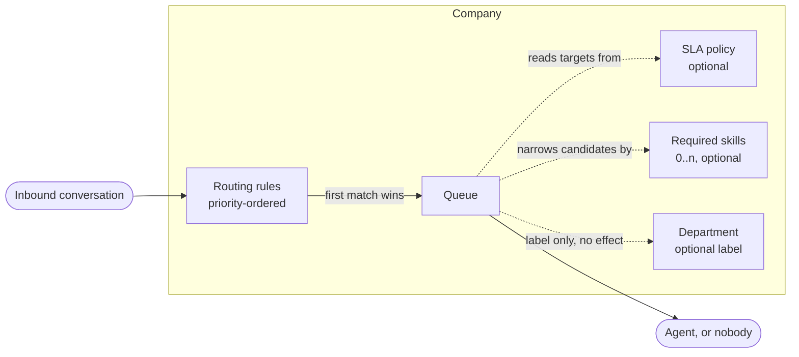
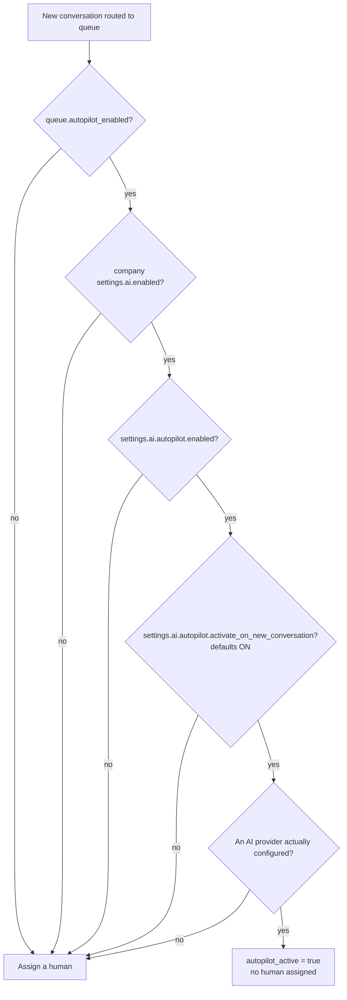
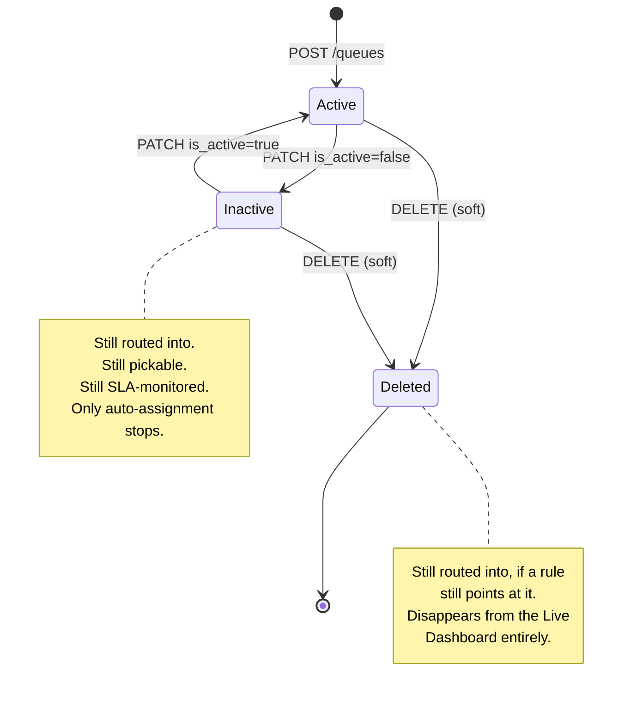

# Queue Architecture

**What a queue is in Blink Engage, every setting on it, and exactly what
each setting changes — and does not change.**

Written for an administrator configuring queues through the Queues screen
(`/queues`) or the API, with no expectation that you read the source. It
describes the system **as it behaves today**, including the places where
the behaviour will surprise you.

Companion documents:
[queue-lifecycle.md](queue-lifecycle.md) (what happens to a conversation
once it is in a queue), [routing-rules.md](routing-rules.md) (how a
conversation gets into one), [assignment-logic.md](assignment-logic.md)
(who ends up handling it), [sla-engine.md](sla-engine.md) (when it counts
as late). The original design records are
[queues-routing.md](queues-routing.md) and [sla.md](sla.md); where those
and the running code disagree, the disagreement is listed at the bottom
of the relevant document here.

---

## 1. What a queue is

A queue is a **named waiting line for conversations**, plus four pieces of
configuration attached to that line:

1. **An assignment policy** — whether the system hands waiting
   conversations to an agent automatically, and how it picks one.
2. **An SLA configuration** — how long a first reply and a resolution are
   allowed to take before the conversation is flagged as late.
3. **A skill gate** (optional) — which agents are allowed to work this
   queue at all.
4. **An AI Autopilot opt-in** (optional) — whether brand-new
   conversations landing here are answered by AI instead of a human.

A queue is **not** a folder, a team, or a permission boundary. It does not
own conversations, it does not restrict who can *see* a conversation, and
it does not, on its own, pull work towards any particular group of people.



### Where queues sit relative to everything else

| Concept | Relationship to a queue |
|---|---|
| **Conversation** | Carries `queue_id`. Set once, when routing first matches, or later by an explicit move. Never cleared. |
| **Routing rule** | Points *at* a queue. Rules are how conversations enter queues; a queue never pulls conversations by itself. |
| **Agent** | Not attached to a queue in any way. Eligibility is computed at assignment time from company + status + skills. |
| **Department** | Stored on the queue as `department_id`, purely as a label (see §3). |
| **SLA policy** | Assigned to a queue via `sla_policy_id`; one policy can serve any number of queues. |
| **Team** | No relationship whatsoever. Teams do not affect queues today. |

---

## 2. Every field on a queue

| Field | Type | Default | What it changes | What it does **not** change |
|---|---|---|---|---|
| `name` | text, ≤255 | required | Display name; unique among a company's non-deleted queues. | Nothing behavioural. |
| `description` | text, ≤1000 | `null` | Display only. | Nothing. |
| `department_id` | FK, nullable | `null` | Groups the queue under a department **on reports and the Live Dashboard only**. | Does **not** restrict which agents can be assigned or which agents may pick. See §3. |
| `assignment_strategy` | `manual` \| `round_robin` \| `least_load` | **`manual`** | Whether and how a brand-new conversation entering the queue is auto-assigned. | Does not affect manual pickup, transfer, or supervisor assignment — all three work identically on all three strategies. |
| `first_response_target_minutes` | int > 0, nullable | `null` | Legacy first-response SLA target, in plain wall-clock minutes. | **Ignored entirely** while an active `sla_policy_id` is set. |
| `resolution_target_minutes` | int > 0, nullable | `null` | Legacy resolution SLA target, plain wall-clock. | Same — ignored while an active policy is assigned. |
| `sla_policy_id` | FK, nullable | `null` | Takes over both SLA targets, adds warning thresholds, business hours and escalation. | Does not change routing or assignment. |
| `autopilot_enabled` | bool | `false` | Lets AI answer **new** conversations routed here, instead of assigning a human. | Does not enable AI for existing conversations, and does nothing unless three company-level switches are also on (§5). |
| `is_active` | bool | `true` | Blocks **auto-assignment** into the queue. | Does **not** block routing into it, manual pickup from it, or SLA monitoring of it. See §6 — this is the single most commonly misread field. |

`assignment_strategy` and `is_active` are the only two fields an
administrator changes routinely. Everything else is set once.

### `null` means "leave unchanged"

`PATCH /queues/{id}` treats `null` on **every** optional field as "leave
this alone", never as "clear it". There is therefore **no way through the
API to clear** `department_id`, `description`, or `sla_policy_id` back to
unset once set. You can only replace them with a different value. To
genuinely unset one, delete the queue and recreate it.

---

## 3. `department_id` is a label, not a filter

This deserves its own section because it is the most frequently assumed
behaviour that does not exist.

Setting a queue's department **does not**:

- restrict assignment to agents in that department;
- restrict who may pick a conversation from the queue;
- affect routing;
- affect SLA.

It affects exactly one thing: the Live Dashboard's queue table shows the
department name in a column, and groups reporting by it. Every agent in
the company remains equally eligible for a departmental queue.

If you need a queue only certain people can work, use **required skills**
(§4). That is the only eligibility mechanism that exists.

Note that `Conversation.department_id` is a *different, unrelated* column:
it is set when somebody transfers a conversation to a department, and it
has no connection to the department on its queue.

---

## 4. Required skills — the only eligibility gate

A queue may have zero or more **required skills**. Skills are free-text
names in a per-company catalog, created on first use.

- **Zero required skills → no restriction.** Every non-deleted agent in
  the company is eligible.
- **One or more required skills → "any of" matching.** An agent is
  eligible if they hold **at least one** of the queue's required skills.
  It is *not* an "all of" match. A queue requiring `spanish` and
  `billing` is workable by an agent who holds only `spanish`.

The same eligibility check runs for auto-assignment and for manual
pickup, so the two can never disagree about who is allowed in.

```
Queue "Spanish Billing"
  required skills: {spanish, billing}      ← ANY-of

Agent A: {spanish}          → eligible
Agent B: {billing}          → eligible
Agent C: {spanish, billing} → eligible
Agent D: {french}           → not eligible
Agent E: {}                 → not eligible
```

**A queue whose required skill nobody holds simply never auto-assigns.**
It does not fall back to an unskilled agent, and it does not error. The
conversation waits indefinitely, and no notification is raised about it.

### Managing skills

| Action | Call |
|---|---|
| Add a required skill to a queue | `POST /queues/{id}/required-skills` with body `{"skill_name": "spanish"}` — creates the skill in the catalog if it does not exist |
| Remove one | `DELETE /queues/{id}/required-skills/{skill_name}` |
| List a queue's required skills | **No endpoint exists.** See §9. |
| Grant a skill to an agent | `POST /agents/{id}/skills` with `{"skill_name": "spanish"}` |
| List an agent's skills | `GET /agents/{id}/skills` |
| Revoke | `DELETE /agents/{id}/skills/{skill_name}` |

Because there is no way to read a queue's current required skills back,
the Queues screen deliberately has no Required Skills tab. Today skills
must be managed by API, and you must keep your own record of what each
queue requires.

---

## 5. AI Autopilot on a queue

`autopilot_enabled` is one of **four** switches that must all be on
before a new conversation routed to this queue is answered by AI instead
of being assigned to a human:



If any gate is off, the queue behaves as a completely ordinary queue and
its assignment strategy runs normally. A conversation is never both
Autopilot-held and agent-assigned; the moment a human claims, is
transferred, or is assigned it, `autopilot_active` is cleared.

An Autopilot conversation still gets `queue_id` and `queue_entered_at`,
still publishes `conversation.queued`, and still appears in queue
metrics — only the *assignment* step is skipped. Full detail in
[ai-engine.md](ai-engine.md).

---

## 6. The lifecycle of a queue's configuration



### Deactivating a queue (`is_active = false`)

This stops **one** thing: automatic assignment. Everything else keeps
running.

- Routing rules pointing at the queue **keep matching**, and new
  conversations are still stamped with this `queue_id` and
  `queue_entered_at`, and still publish `conversation.queued`.
- Agents can still **pick** conversations out of it.
- The SLA sweep still evaluates its conversations and still raises
  warnings, breaches and escalations.
- It still appears on the Live Dashboard (the dashboard filters on
  *deleted*, not on *active*).

*Verified live:* a queue was set `is_active: false`, a matching routing
rule left in place, and a Web Chat message sent. The resulting
conversation carried the inactive queue's `queue_id`, had
`queue_entered_at` set, published `conversation.queued`, and was left
unassigned. An offline agent then picked it successfully.

**If your intent is "stop sending work here", deactivating the queue is
not enough — you must deactivate or delete the routing rules that point
at it.**

### Deleting a queue (soft delete)

`DELETE /queues/{id}` is a soft delete: the row is marked deleted and
disappears from `GET /queues`, from the Queues screen, and from the Live
Dashboard. It does **not**:

- clear `queue_id` on conversations already in the queue;
- delete or deactivate routing rules that point at it — those rules stay
  active and **keep routing new conversations into the deleted queue**.

*Verified live:* a queue was created with a catch-all routing rule, then
deleted. The rule remained listed and active. A subsequent Web Chat
message produced a conversation with `queue_id` set to the deleted queue
and `queue_entered_at` populated — and `GET /reports/live-dashboard`
returned **no queues at all**, so that conversation was invisible in
every queue view while still sitting unassigned.

**Always delete or repoint the routing rules first, then delete the
queue.** There is no warning, no referential check, and no report that
surfaces conversations parked in a deleted queue.

Because the unique-name index only covers non-deleted rows, you can
immediately re-create a queue with the same name after deleting one —
but the new queue is a different row with a different id, and old rules
will still point at the old, deleted one.

---

## 7. Worked example

### Setting up a Spanish billing queue

Goal: WhatsApp messages mentioning "factura" go to a queue worked only by
Spanish-speaking agents, auto-assigned to whoever is least loaded, with a
15-minute first-response target measured against business hours.

```
1. Create the SLA policy (SLA Builder → Policies)
   name:                          Standard Support
   first_response_target_minutes: 15
   resolution_target_minutes:     480
   warning_threshold_percent:     80
   business_hours_aware:          true

2. Create the queue (Queues → Queues tab)
   name:                Spanish Billing
   assignment_strategy: least_load
   sla_policy_id:       <Standard Support>
   department_id:       (leave empty — it changes nothing)

3. Gate it by skill (API only — no UI)
   POST /queues/<id>/required-skills   {"skill_name": "spanish"}

4. Grant the skill to the people who should work it
   POST /agents/<agent-id>/skills      {"skill_name": "spanish"}

5. Point traffic at it (Queues → Routing Rules tab)
   priority:        10
   conditions:      {"channel_type": "whatsapp", "body_contains": "factura"}
   target_queue_id: <Spanish Billing>
```

What now happens to a WhatsApp message reading *"Hola, tengo una duda con
mi factura"*:

| Step | Outcome |
|---|---|
| Routing | Rule at priority 10 matches both conditions → `queue_id = Spanish Billing`, `queue_entered_at = now`, `conversation.queued` published |
| Eligibility | Every non-deleted agent whose status is not `offline` and not `busy`, narrowed to those holding `spanish` |
| Assignment | `least_load` picks whichever of those has the fewest open/pending conversations company-wide |
| SLA | First-response deadline = 15 **business** minutes after the conversation was created; warning at 12 business minutes (80% of 15, floored) |

### The example that surprises people

Same setup, but **nobody has been granted the `spanish` skill yet** — a
common state on day one, because skills must be granted through the API
and are easy to forget.

| Step | Outcome |
|---|---|
| Routing | Still matches. `queue_id` set, `conversation.queued` published. |
| Eligibility | Candidate list narrows to **empty**. |
| Assignment | Returns nobody. No error, no log an administrator sees, no notification. |
| Live Dashboard | The conversation shows under `waiting_count` for Spanish Billing, and its wait time climbs. |
| SLA | The 15-minute clock runs normally and will breach — **the breach is the only signal that the queue is unworkable.** |

The system never falls back to an ineligible agent, and never warns you
that a queue's skill gate has no members. If you gate a queue by skill,
check that at least one agent holds the skill.

---

## 8. Permissions

| Permission | Grants | Default roles |
|---|---|---|
| `queues.read` | View queues, required skills and routing rules | Owner, Admin, Agent |
| `queues.manage` | Create/edit/delete queues, required skills and routing rules | Owner, Admin |
| `sla_policies.read` | View SLA policies and holidays | Owner, Admin, Agent |
| `sla_policies.manage` | Create/edit/delete policies and holidays | Owner, Admin |
| `agents.manage` | Grant/revoke an agent's skills | Owner, Admin |

SLA policies are deliberately a **separate** permission pair from
`queues.manage`, so a company can let queue administrators reorganise
queues without letting them change contractual response targets.

Every queue read and write is scoped to the caller's own company. A
cross-tenant request returns 404, not 403.

---

## 9. What queue configuration does not do

Stated plainly, because none of these are inferable from the screens:

- **No queue-level agent membership.** You cannot say "these five agents
  work this queue". The only narrowing mechanism is required skills.
- **No team or department eligibility.** Neither `Queue.department_id`
  nor an agent's department or team membership affects eligibility.
- **No queue capacity, concurrency limit, or WIP cap.** A queue accepts
  unbounded work, and an agent can be auto-assigned an unlimited number
  of conversations.
- **No queue business hours.** Business hours are a *company* setting
  consumed only by business-hours-aware SLA policies. A queue cannot be
  "closed at night", and nothing stops conversations being routed into it
  outside working hours.
- **No overflow, fallback or spillover queue.** If a queue cannot be
  worked, conversations simply accumulate.
- **No priority per queue.** `Conversation.priority` is a per-conversation
  triage label; it does not change SLA targets and does not change
  assignment order.
- **No way to list a queue's required skills.** Add and remove exist;
  read does not.
- **No way to clear** `department_id`, `description` or `sla_policy_id`
  back to unset.
- **No warning when a queue becomes unworkable** (no eligible agents, no
  matching rules, deleted while rules still point at it).
- **No record of why a conversation is in this queue.** The matching rule
  is known at the instant it matches and is then discarded; only
  `queue_id` survives. This is the gap the explainability milestone
  exists to close.

---

## 10. Where to look next

| Question | Document |
|---|---|
| How does a conversation get into a queue? | [routing-rules.md](routing-rules.md) |
| What happens to it while it is there? | [queue-lifecycle.md](queue-lifecycle.md) |
| Who does it get given to, and why? | [assignment-logic.md](assignment-logic.md) |
| When does it count as late? | [sla-engine.md](sla-engine.md) |
| Why did AI answer it? | [ai-engine.md](ai-engine.md) |
| What do the dashboard numbers mean? | [reports-analytics.md](reports-analytics.md) and [queue-lifecycle.md](queue-lifecycle.md) §7 |
| Original design rationale | [queues-routing.md](queues-routing.md), [sla.md](sla.md) |

---

## 11. Known discrepancies with existing documentation

Recorded, not resolved. In each case the **code** is what happens.

1. **Live Dashboard scope — "per active queue" is wrong.**
   `queues-routing.md` § "Live Dashboard metrics" says
   `GET /reports/live-dashboard` returns metrics "per active queue".
   `ReportingRepository.queue_metrics()` filters on
   `Queue.deleted_at IS NULL` only. **Inactive queues do appear on the
   dashboard**; soft-deleted ones do not.

2. **`POST /queues/{id}/required-skills/{skill_name}` does not exist.**
   `queues-routing.md` § "API" lists `POST/DELETE
   /queues/{id}/required-skills/{skill_name}`. The real POST is
   `POST /queues/{id}/required-skills` with a JSON body
   `{"skill_name": ...}`; only DELETE takes the name in the path.

3. **The four-gate Autopilot check is described as two.**
   `queues-routing.md` decision #11 calls it "the full two-opt-in gate".
   `_route_and_assign` checks four conditions plus provider
   availability, including
   `settings.ai.autopilot.activate_on_new_conversation` (added later,
   documented in `sla.md`'s addendum but not in decision #11).

4. **Nothing documents that routing survives deactivation and
   deletion.** Neither existing document states that routing rules keep
   matching into an inactive queue, or that they keep matching into a
   *soft-deleted* queue whose conversations then vanish from every queue
   view. Both were verified live against the running stack.

Discrepancies specific to routing, assignment and SLA are listed in
[routing-rules.md](routing-rules.md) §9,
[assignment-logic.md](assignment-logic.md) §9 and
[sla-engine.md](sla-engine.md) §10.
