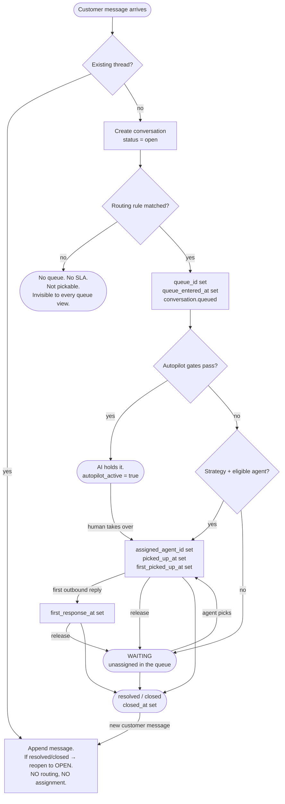
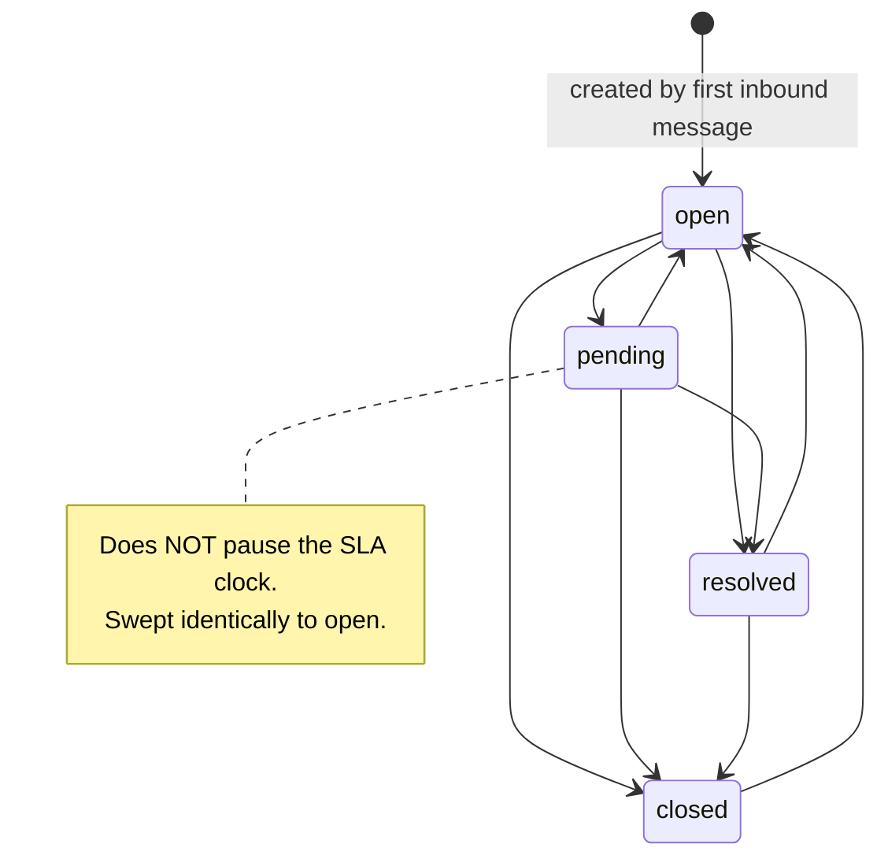

# Queue Lifecycle

**The life of one conversation, from the moment a customer's first
message arrives to the moment it is closed — told through the queue.**

This is the document to read when you are looking at a conversation and
asking *what state is it actually in, and how did it get here*. It
explains every timestamp the platform writes, who writes it, who clears
it, and what each dashboard number is really counting. It describes the
system **as it behaves today**.

Companion documents: [queue-architecture.md](queue-architecture.md)
(configuration), [routing-rules.md](routing-rules.md) (how it entered),
[assignment-logic.md](assignment-logic.md) (who took it),
[sla-engine.md](sla-engine.md) (when it counts as late).

---

## 1. The whole journey



Two structural facts govern everything below:

- **Routing and auto-assignment happen once, at creation, and never
  again.** Every later movement is somebody pressing a button, or an SLA
  escalation rule you configured.
- **`queue_id` is a permanent tag.** Once set it is never cleared — not
  by pickup, not by release, not by transfer, not by resolution. A
  closed conversation still names the queue it came from. Only an
  explicit move to a *different* queue changes it.

---

## 2. Conversation status

Four values. There is no `waiting`, no `active`, no `escalated`, no
`snoozed`.



Transitions not shown are rejected. Two ways a conversation returns to
`open`:

| Route | Behaviour |
|---|---|
| `PATCH /conversations/{id}` with `status: open` | Publishes `conversation.updated`. Leaves the stale `closed_at` in place |
| **A new inbound customer message** on a `resolved`/`closed` thread | Silently flips the status to `open` and clears `closed_at`. **Publishes no status event at all** — the only record is the new `message.persisted` |

Neither route re-routes, re-assigns, or re-arms the SLA. A reopened
conversation keeps `first_response_at` and every SLA marker it already
had, so it is effectively outside SLA for the rest of its life — see
[sla-engine.md](sla-engine.md) §4.

---

## 3. Every timestamp, and who touches it

| Column | Meaning | Written by | Cleared by |
|---|---|---|---|
| `created_at` | First inbound message persisted. **Both SLA clocks start here** | Database, at insert | Never |
| `queue_entered_at` | Start of the *current* unowned wait | Routing at creation; `PATCH` that changes `queue_id`; **`release()`**; SLA `reassign_queue` | Never cleared, but **overwritten** by each of the above |
| `picked_up_at` | The *current* claim | Auto-assignment; `pick()`; Autopilot takeover | **`release()` sets it back to `null`** |
| `first_picked_up_at` | The **first ever** claim, for "was this ever handled by anyone" | Auto-assignment; `pick()`; Autopilot takeover | Never — written once and kept |
| `first_response_at` | First **successful** outbound message (human or AI) | `send_reply()` | Never |
| `sla_first_response_warned_at` | When the sweep *noticed* the warning threshold | SLA sweep | Never |
| `sla_first_response_breached_at` | When the sweep *noticed* the breach | SLA sweep | Never |
| `sla_resolution_warned_at` / `sla_resolution_breached_at` | Same, for the resolution clock | SLA sweep | Never |
| `closed_at` | Entry into `resolved` **or** `closed` | `PATCH` on a terminal transition, overwritten each time | Cleared **only** by a reopen triggered by an inbound message |
| `last_message_at` | Newest message in either direction | Ingest; `send_reply()` | Never |
| `autopilot_active` | AI currently owns the reply | Routing, when the Autopilot gates pass | Cleared by `pick()`, `transfer()`, `PATCH` assignment, and takeover |

Two of these are routinely misread:

**The SLA timestamps record detection, not the deadline.** The sweep runs
once a minute, so `sla_first_response_breached_at` is the moment the
sweep *saw* the breach — up to 60 seconds after the actual deadline. The
deadline itself is never stored anywhere.

**`picked_up_at` and `first_picked_up_at` are different questions.**
"Who has it now" versus "did anyone ever take it". A pick-then-release
cycle clears the first and leaves the second, which is exactly the
distinction the abandonment metric needs.

**`transfer()` and `PATCH` assignment set neither.** A conversation
handed to an agent by a supervisor has no `picked_up_at` at all — see §5.

---

## 4. The dashboard's five "stages"

The Live Dashboard shows queue stages, but there is no stage column in
the database. Every stage is derived at read time from the columns above.

```
                     ┌──────────────────────────────────────────┐
                     │  status IN (open, pending), this queue    │
                     └──────────────────────────────────────────┘
                                       │
             ┌─────────────────────────┴─────────────────────────┐
             │                                                   │
   assigned_agent_id IS NULL                        assigned_agent_id IS NOT NULL
             │                                                   │
        ┌────┴────┐                            ┌─────────────────┴─────────────────┐
        │ WAITING │                            │                                   │
        └─────────┘                  first_response_at IS NULL          first_response_at IS NOT NULL
                                              │                                   │
                                         ┌────┴────┐                        ┌──────┴─────┐
                                         │ PICKED  │                        │   ACTIVE   │
                                         └─────────┘                        └────────────┘

   RESOLVED (24h) = reached resolved in the last 24h    ┐  these two are the
   CLOSED   (24h) = reached closed   in the last 24h    ┘  "last 24 hours" pair
```

`assigned_count = picked_count + active_count` and
`throughput_24h = resolved_24h + closed_24h` always hold.

### Every Live Dashboard number, precisely

| Field | Exactly what it counts |
|---|---|
| `open_conversations` | `open`/`pending` in this queue, assigned or not |
| `waiting_count` | …of those, `assigned_agent_id IS NULL` |
| `assigned_count` | …of those, `assigned_agent_id IS NOT NULL` |
| `picked_count` | assigned, `first_response_at IS NULL` |
| `active_count` | assigned, `first_response_at IS NOT NULL` |
| `avg_wait_seconds` | mean of `now − queue_entered_at` over the **currently waiting** set. Conversations with no `queue_entered_at` are skipped, so this can be `null` even while `waiting_count` is non-zero |
| `longest_wait_seconds` | max of the same set |
| `pickup_avg_seconds_24h` | mean of `picked_up_at − queue_entered_at` for conversations whose **current** `picked_up_at` falls in the last 24h. No status filter — resolved and closed ones count |
| `sla_breached_count` | `open`/`pending` in this queue with **either** breach marker set |
| `abandoned_count_24h` | `resolved`/`closed`, `closed_at` in the last 24h, **and** `assigned_agent_id IS NULL`, **and** `first_picked_up_at IS NULL` |
| `throughput_24h` | `resolved`/`closed` with `closed_at` in the last 24h |
| `resolved_24h` / `closed_24h` | the split of the above by terminal status |

The dashboard lists every **non-deleted** queue, including deactivated
ones. Soft-deleted queues vanish from it entirely — along with any
conversations still sitting in them.

---

## 5. Worked example — a normal conversation, minute by minute

```
Queue      Support        strategy: manual, no required skills
SLA policy first response 15 min, resolution 480 min, warning 80%,
           business-hours-aware, company hours Mon-Fri 09:00-17:00 UTC
```

| Time (Tue) | What happens | Columns written | Stage |
|---|---|---|---|
| 10:00:00 | WhatsApp: *"my invoice is wrong"*. New conversation | `created_at=10:00:00` | — |
| 10:00:00 | Rule `{"body_contains":"invoice"}` matches | `queue_id=Support`, `queue_entered_at=10:00:00` → `conversation.queued` | **Waiting** |
| 10:00:00 | Strategy is `manual` → no auto-assignment | — | Waiting |
| 10:12 | Sweep: 12 business minutes elapsed (80% of 15, floored) | `sla_first_response_warned_at=10:12` → `conversation.sla_warning` | Waiting |
| 10:14:30 | Ben clicks **Pick** | `assigned_agent_id=Ben`, `picked_up_at=10:14:30`, `first_picked_up_at=10:14:30` → `conversation.picked` (`wait_seconds: 870`) | **Picked** |
| 10:16 | Sweep: the 10:15 deadline passed and no reply was sent | `sla_first_response_breached_at=**10:16**` → `conversation.sla_breached` | Picked |
| 10:17 | Ben replies | `first_response_at=10:17`, `last_message_at=10:17` → `message.sent` | **Active** |
| 11:30 | Ben marks it Resolved | `status=resolved`, `closed_at=11:30` → `conversation.updated` + `conversation.resolved` | Resolved |

Note the breach timestamp: **10:16, not 10:15**. The deadline was 10:15;
the sweep noticed a minute later, and the deadline itself is not stored.
Picking a conversation up does not stop the first-response clock — only
replying does.

At 11:31 this conversation contributes `+1` to `resolved_24h` and
`throughput_24h`, and **nothing** to `abandoned_count_24h` (it was
claimed, so `first_picked_up_at` is set).

---

## 6. Worked example — the one that surprises people

Same queue. A conversation is picked up, released a minute later, and
nobody ever claims it again.

```
Wed 09:00:00  Routed into Support        queue_entered_at = 09:00:00
Wed 09:05:00  Ana picks it               picked_up_at       = 09:05:00
                                         first_picked_up_at = 09:05:00
Wed 09:06:00  Ana releases it            assigned_agent_id  = null
                                         picked_up_at       = null   ← cleared
                                         queue_entered_at   = 09:06:00 ← RESET
                                         first_picked_up_at = 09:05:00 (kept)
Wed 12:00:00  A supervisor closes it     status = closed, closed_at = 12:00:00
```

Now read the dashboard at 11:00, while it is still waiting:

| Number | Value | Why it is not what you expect |
|---|---|---|
| `longest_wait_seconds` | **1h 54m** | Measured from `09:06`, not `09:00`. **Releasing a conversation restarts the reported wait**, so the customer's real 2-hour wait is understated by the six minutes before Ana touched it. This is deliberate — the metric answers "how long has this been unowned *this time*" — but it is not the customer's experience |
| `pickup_avg_seconds_24h` | **excludes this conversation entirely** | The average uses the *current* `picked_up_at`, which `release()` cleared. A conversation that was picked up inside the window but later released contributes nothing at all |

And after it is closed at 12:00:

| Number | Value | Why |
|---|---|---|
| `throughput_24h` / `closed_24h` | **+1** | It reached a terminal status in the window |
| `abandoned_count_24h` | **+0** | `first_picked_up_at` is set, so the system knows somebody engaged. It is *not* classified as never-handled |

Contrast that with a conversation nobody ever touched, closed the same
way: it counts in **both** `throughput_24h` and `abandoned_count_24h`.
That difference — "someone engaged then it stalled" versus "nobody ever
engaged" — is the entire reason `first_picked_up_at` exists as a separate
column.

**One more asymmetry worth knowing:** a conversation transferred to a
*department* (which clears `assigned_agent_id` and never sets
`first_picked_up_at`), worked on by that department, and then closed
satisfies both abandonment conditions and **is counted as never
handled**. The metric is reliable for the pick/auto-assign workflow it
was designed around, and misleading for a company that works primarily
through transfers.

---

## 7. Events emitted along the way

Every step publishes a durable domain event through the outbox, which is
what feeds the audit log, notifications, reporting and the workflow
engine.

| Moment | Event | Notable payload |
|---|---|---|
| Conversation created | `conversation.created` | customer, channel |
| Every inbound message | `message.persisted` | body, direction |
| Routed into a queue | `conversation.queued` | `queue_id` — **not** which rule matched |
| Auto-assigned | `conversation.assignment_changed` | `agent_id`, `previous_agent_id: null` |
| Picked | `conversation.picked` | `queue_id`, `agent_id`, `wait_seconds` |
| Released | `conversation.released` | `queue_id`, `previous_agent_id` |
| Transferred | `conversation.transferred` | target type, from/to, free-text note |
| Assignee changed by `PATCH` | `conversation.updated` **and** `conversation.assignment_changed` | |
| Agent replies | `message.sent` | AI-provenance flags |
| SLA warning / breach | `conversation.sla_warning` / `conversation.sla_breached` | `breach_type`, `queue_id` — **not** the deadline or the policy |
| Resolved / closed | `conversation.updated` **and** `conversation.resolved` / `conversation.closed` | `previous_status` |
| Taken back from AI | `conversation.autopilot_stopped` | |
| Reopened by a customer message | **nothing** | See §2 |

Configuration changes (`queue.*`, `routing_rule.*`, `sla_policy.*`,
`holiday.*`) publish their own events and land in the audit log with the
acting user — but those record what an administrator *changed*, never what
the engine *decided*.

---

## 8. What the lifecycle does not do

- **No re-routing and no re-assignment after creation** (§1).
- **No re-queue on release.** A released conversation returns to the
  shared pool and waits for a human; it is never auto-assigned again,
  whatever the queue's strategy.
- **No timeout on waiting.** A conversation can wait forever. Nothing
  expires it, escalates it, or alerts on it except an SLA policy you
  configured.
- **No `queue_id` clearing.** A resolved conversation still names its
  queue, and a conversation moved from Tier 1 to Tier 2 loses all record
  of ever having been in Tier 1 — the column holds the *current* queue
  only, and there is no queue history table.
- **No event when a conversation is reopened by a customer** (§2).
- **No event, log or flag when routing finds no match**, or when
  assignment finds no eligible agent. Both are silent.
- **No stored deadline or countdown.** The conversation API returns the
  four after-the-fact SLA timestamps and nothing forward-looking; no
  screen shows an agent how long they have left.
- **No "wait time since the customer's last message".** The only wait
  clock is `queue_entered_at`, which measures unowned time in a queue and
  is reset by release and by queue moves.
- **No decision record anywhere.** `conversation.queued` says which
  queue, not which rule. `conversation.assignment_changed` says which
  agent, not which strategy or who else was considered.
  `conversation.sla_breached` says that it breached, not against what.
  **The four questions an administrator actually asks — why this queue,
  why this agent, why this breach, why is it still waiting — cannot be
  answered from what the platform stores today.** That is the gap the
  explainability milestone exists to close.

---

## 9. Where to look next

| Question | Document |
|---|---|
| How did it get into this queue? | [routing-rules.md](routing-rules.md) |
| Why this agent? | [assignment-logic.md](assignment-logic.md) |
| Why is it late? | [sla-engine.md](sla-engine.md) |
| What can I configure on the queue? | [queue-architecture.md](queue-architecture.md) |
| Why did AI answer? | [ai-engine.md](ai-engine.md) |
| Conversation model, statuses, transfers in general | [conversations.md](conversations.md) |
| Historical reporting rather than live counts | [reports-analytics.md](reports-analytics.md) |
| How events reach consumers | [event-bus.md](event-bus.md) |

---

## 10. Known discrepancies with existing documentation

Recorded, not resolved. The **code** is what happens.

1. **`abandoned_count_24h` is defined differently in the code.**
   `queues-routing.md` § "Live Dashboard metrics" describes it as
   "**queued** in the last 24h, now closed, and `first_picked_up_at IS
   NULL`". The query filters on `closed_at >= cutoff` (**closed** in the
   last 24h, whenever it was queued) and additionally requires
   `assigned_agent_id IS NULL`.

2. **The Live Dashboard is described as covering "active" queues.** It
   filters on `Queue.deleted_at IS NULL` only, so deactivated queues are
   included (§4).

3. **`first_picked_up_at` has a third writer.** Decision #7 names two
   (`ConversationRepository.claim()` and the ingest consumer);
   `ConversationService.take_over_from_autopilot()` is a third.

4. **`conversation.assignment_changed` does not fire for every
   assignment.** Decision #9 presents it as the single event a consumer
   needs for "this conversation now has an assigned agent". `pick()`,
   `transfer()` and Autopilot takeover all change the assignee without
   publishing it (§7).

5. **The silent reopen is undocumented.** No existing document notes
   that an inbound message on a resolved/closed conversation flips it back
   to `open` and clears `closed_at` while publishing no conversation-level
   event, or that a reopen via `PATCH` leaves the stale `closed_at` in
   place.

6. **The metric consequences of `release()` are undocumented.** Neither
   document notes that release resets `queue_entered_at` (understating
   reported wait) or clears `picked_up_at` (removing the conversation
   from the pickup-time average altogether) — see §6.

---

## Ownership

**Ownership is operational responsibility. It is not assignment.**

Assignment is a conversation on somebody's screen. Ownership is the answer to
*"if nothing happens, whose problem is that?"*. They coincide often enough to
be confused and differ exactly where it matters.

Status, queue and owner are **three independent facts**. A conversation can be
`in_progress` and owned by nobody (the agent went offline), `waiting` and owned
by its queue, `resolved` and still owned by whoever resolved it. None of those
are contradictions, and treating them as one fact is what made the old
four-status model ambiguous.

### Who can own, and what that obliges them to do

| Owner | Responsible for |
|---|---|
| Queue | **Pickup** — somebody must take this |
| Agent | **Customer communication** |
| AI queue worker | **Automated engagement**, within the service's AI policy |
| Team | **Pickup**, held by a named group |
| Supervisor | **Escalation** — whatever the escalation was about |
| Nobody | **Nothing.** An exceptional state, never a resting one |

`NOBODY` and `QUEUE` are different values rather than one null, because
"unassigned" and "unowned" are different words and only one is a problem.
Every path in the platform hands a conversation to its *queue* rather than to
nobody — so a conversation found unowned means something went wrong that was
not caught, and the value exists precisely so it can be found.

AI likewise has a kind of its own. Recording "AI has it" as "nobody has it"
would make the moment AI hands back a transition from nothing.

### Transfer reasons are structured, never free text

Fifteen closed codes: `new_conversation`, `picked_by_agent`,
`assigned_by_strategy`, `ai_engagement`, `manual_transfer`, `escalation`,
`supervisor_override`, `sticky_continuation`, `customer_replied`,
`released_by_owner`, `ai_released`, `ownership_expired`,
`conversation_resolved`, `conversation_closed`, `owner_unavailable`.

`note` exists and is **additive**: it can say which supervisor asked and what
the escalation was about; it can never say *why* ownership moved. A timeline
whose reasons were prose could not be grouped, filtered or counted, and every
metric below would become a string-matching exercise.

`new_conversation` is deliberately distinct from a later return to the queue.
One code meaning both would make "average time until pickup" unanswerable —
the query could not tell a conversation's first row from its fourth.

### Metrics, without schema changes

Every figure is derived from the rows already written:

| Metric | Derived from |
|---|---|
| Average queue / AI / agent / supervisor ownership time | Each row holds until the next; the last holds until now |
| Number of ownership transfers | Row count minus one — the arrival is not a hand-over |
| Average time until pickup | First `human_agent` row minus the conversation's creation |
| Average time until AI engagement | First `ai_queue_worker` row minus the same |

An `owned_until` column would be the obvious optimisation and is deliberately
absent: writing it means updating the *previous* row, which breaks the
append-only history the model rests on. A test asserts no duration column
exists, so the optimisation cannot arrive by accident.

Durations are dialect-aware — PostgreSQL subtracts timestamps into an interval
that `EXTRACT(EPOCH …)` reads, SQLite has neither and needs `julianday()`. That
is not a detail: the first version silently returned figures wrong by a factor
of billions on SQLite rather than raising, which is why the metrics have a test
rather than a claim.

### The Ownership Inspector

`GET /api/v1/conversations/{id}/ownership` answers, without making anybody read
a list: the **current owner** and what they are responsible for, **owner
since** and how long, the **previous owner**, the **transfer reason** in code
and in words, the **number of transfers**, and the full **timeline** with how
long each hop lasted.

### Sticky ownership

An owner may keep a conversation after they stop working it, so a customer
replying twenty minutes later reaches the person who already knows them.
Configurable per service — `sticky` (24 hours by default), `immediate`,
`on_resolve`, `on_close`.

Only a **person's** hold expires. A queue owning a conversation is not a claim
that runs out: it is answerable until somebody takes it, and a queue whose
ownership timed out would leave the conversation owned by nobody — the one
outcome this model exists to avoid.

A lapsed hold does not release itself. The timeline is append-only, so
`release-expired-ownership` (every five minutes) notices and writes the next
row, handing the conversation back to its **queue**. It touches neither the
status nor the queue itself.

## Who writes an ownership transition

Every path that changes who is answerable for a conversation, and the reason
it records:

| Action | Owner becomes | Reason |
|---|---|---|
| Conversation arrives in a queue | The queue | `new_conversation` |
| Assignment engine picks an agent | That agent | `assigned_by_strategy` |
| AI takes it from the queue | AI | `ai_engagement` |
| **An agent picks it up** | **That agent** | **`picked_by_agent`** |
| **An agent releases it** | **Its queue** | **`released_by_owner`** |
| **A supervisor transfers it** | **The target** | **`manual_transfer`** |
| AI hands back to humans | Its queue | `ai_released` |
| A sticky window expires | Its queue | `ownership_expired` |

The three in bold were missing until the M5 lifecycle verification looked for
them. `ConversationService` had no ownership dependency at all, so pick,
release and transfer — the most common actions in the product, and the only
ones a *person* performs — left the timeline untouched. Only the automatic
paths recorded anything, which meant a conversation an agent was holding still
showed its last automatic owner: "who is responsible for this?" answered with
whoever the platform last gave it to, not whoever actually had it.

Recording never costs the action. Taking a conversation is the product; the
row explaining it is evidence, and evidence that would not write must not stop
an agent picking something up.

**Still not recorded:** resolving and closing. `ReleasePolicy` has `ON_RESOLVE`
and `ON_CLOSE` members and nothing consults them — whether a resolved
conversation stays with its agent or returns to its queue is a per-service
ownership rule that does not exist yet. Left deliberately rather than guessed
at, since inventing the answer would bake a default nobody chose into the
timeline.
