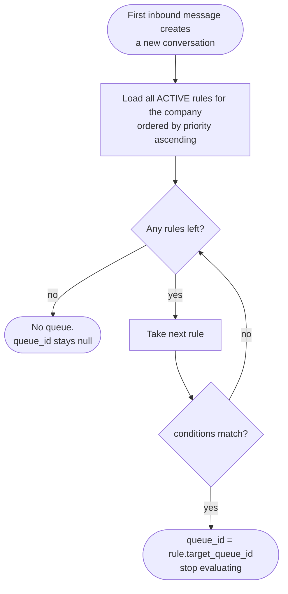

# Routing Rules

**How Blink Engage decides which queue a brand-new conversation goes
into.**

Written for an administrator authoring rules on the Queues screen
(`/queues` → Routing Rules tab) or through the API. It describes the
system **as it behaves today**, including several behaviours that will
catch you out.

Companion documents: [queue-architecture.md](queue-architecture.md),
[queue-lifecycle.md](queue-lifecycle.md),
[assignment-logic.md](assignment-logic.md),
[sla-engine.md](sla-engine.md). Original design record:
[queues-routing.md](queues-routing.md).

---

## 1. What a routing rule is

A routing rule is one row of the form:

```
(priority, conditions, target_queue_id, is_active)
```

That is the whole model. There is no branching, no nesting, no
alternative action, and no "else". A rule can do exactly one thing: send
a conversation to one queue.

The rules for a company form a single **priority-ordered list**, and the
**first rule whose conditions match wins**. Nothing after it is
evaluated.



---

## 2. When routing runs — and when it does not

Routing runs **exactly once per conversation**, inside the
conversation-ingest consumer, in the same database transaction that
creates the conversation.

| Event | Does routing run? |
|---|---|
| First inbound message on a new thread | **Yes** |
| Second, third, hundredth message on the same thread | No |
| A resolved/closed conversation reopened by a new customer message | **No** — the conversation already exists, so it keeps whatever `queue_id` it had (or stays queueless forever if it never had one) |
| Agent sends an outbound reply | No |
| A rule is created, edited or deleted | No — existing conversations are never re-evaluated |
| A conversation is transferred | No |

This is the single most important thing to internalise: **routing rules
are a first-touch decision only.** Editing rules changes where *future*
conversations go. It never moves a conversation that is already in a
queue, and it never rescues one that never matched a rule.

To move an existing conversation, use `PATCH /conversations/{id}` with a
`queue_id`, or an SLA escalation rule (see
[sla-engine.md](sla-engine.md) §7). Both are explicit moves, unrelated to
routing rules.

---

## 3. Ordering

Rules are evaluated in **ascending `priority`**. Lower number = evaluated
first = wins.

```
priority 1   → checked first
priority 10
priority 100 ← the default for a new rule
priority 999 → checked last
```

**Ties are not resolved.** Two active rules with the same priority are
returned in whatever order the database produces, and that order is not
guaranteed to be stable between requests. If two rules could both match
the same conversation, give them different priorities — otherwise the
outcome is genuinely unpredictable.

Inactive rules (`is_active = false`) are skipped entirely and do not
occupy a priority slot.

---

## 4. Conditions

`conditions` is a JSON object. **Exactly two keys are understood:**

| Key | Matching | Example |
|---|---|---|
| `channel_type` | **Exact**, case-sensitive string equality against the conversation's channel | `{"channel_type": "whatsapp"}` |
| `body_contains` | **Case-insensitive substring** of the first inbound message's body | `{"body_contains": "refund"}` |

Valid `channel_type` values are the platform's channel identifiers:
`whatsapp`, `telegram`, `messenger`, `instagram`, `email`, `sms`,
`web_chat`.

### Both keys together are AND

```json
{"channel_type": "email", "body_contains": "invoice"}
```
matches only an email whose first message body contains "invoice" in any
casing. There is **no OR**. To express "email OR SMS", write two rules.

### An empty `conditions` object matches everything

```json
{}
```
is a legitimate, intentional catch-all. Give it a high priority number
(e.g. `999`) and put it last, and it becomes a default queue for anything
no other rule claimed.

### `body_contains` and messages with no text

`body_contains` compares against the body of the message that created the
conversation. If that message has **no body** — a bare image, a voice
note, a document with no caption — the condition **cannot match**, and
the rule is skipped. A media-first conversation will fall through to your
next matching rule, or to no queue at all.

### Substring, not word — and not a pattern

`{"body_contains": "cat"}` matches "certificate", "escalate" and
"vacation". There is no word-boundary matching, no regular expressions,
no wildcards, and no stemming. Choose distinctive substrings.

---

## 5. Unrecognised keys are silently ignored — and that makes the rule a catch-all

**This is the sharpest edge in the whole routing system, so it is stated
plainly rather than smoothed over.**

The condition evaluator reads `conditions["channel_type"]` and
`conditions["body_contains"]`. Any other key is neither validated nor
rejected — it is simply not read. A rule whose conditions contain *only*
unrecognised keys therefore has **nothing to fail on, so it matches every
conversation**.

The API accepts any `{"string": "string"}` object with no schema check at
all. That means a single typo silently converts a narrow rule into an
unconditional catch-all:

```json
{"body_contain": "refund"}     ← note the missing "s"
```

*Verified live:* a rule with exactly these conditions was created through
the API and accepted. A Web Chat message reading "probe message for docs
verification" — which contains neither "refund" nor anything like it —
was routed straight into that rule's target queue.

The same applies to any invented key: `{"customer_email": "..."}`,
`{"language": "es"}`, `{"tag": "vip"}` are all accepted, all ignored, and
all behave as `{}`.

**Mitigation:** author rules through the Queues screen's Routing Rules
tab, which composes the two supported keys from a channel dropdown and a
text field and never lets you type a key name. If you must use the API,
double-check the spelling of `channel_type` and `body_contains`, and
never assume a rejected key would have produced an error.

---

## 6. What happens when nothing matches

Nothing. That is the whole behaviour, and it has consequences worth
listing:

- `queue_id` stays `null`, and `queue_entered_at` stays `null`.
- No `conversation.queued` event is published.
- No assignment is attempted — a conversation with no queue is never
  auto-assigned to anybody.
- **No SLA is applied.** The SLA sweep only examines conversations
  joined to a queue, so a queueless conversation has no first-response
  target and no resolution target, forever, regardless of what your SLA
  policies say.
- It cannot be picked (`POST /conversations/{id}/pick` rejects a
  conversation with no queue).
- It appears in the Inbox under Status filtering, but never under Queue
  filtering, and never in any queue metric.

There is **no implicit default queue**. If you want unmatched traffic to
land somewhere, you must author a catch-all rule yourself (§4).

---

## 7. The target queue is barely validated

Three separate gaps, all real:

1. **The target queue is not checked on rule creation.** `POST
   /routing-rules` writes the rule without confirming the queue exists or
   belongs to your company. Passing an id that does not exist anywhere
   fails at the database's foreign key and surfaces as **HTTP 500**, not
   a 404 or a validation error (verified live). Passing another
   company's queue id is not rejected by the application at all.

2. **An inactive target queue is still routed into.** The conversation
   is stamped with the queue, `queue_entered_at` is set, and
   `conversation.queued` is published — *then* the queue's `is_active`
   flag is checked, and only auto-assignment is skipped. Deactivating a
   queue does not stop traffic reaching it.

3. **A soft-deleted target queue is still routed into**, and its rule is
   not deleted with it. Conversations then land in a queue that no
   longer appears in `GET /queues` or on the Live Dashboard — invisible
   in every queue view while sitting unassigned (verified live; see
   [queue-architecture.md](queue-architecture.md) §6).

**Delete or repoint the rules before deleting the queue.**

---

## 8. Worked examples

### Example A — a normal three-rule setup

```
priority   conditions                                              target
--------   ----------------------------------------------------   -------------
      10   {"channel_type":"whatsapp","body_contains":"factura"}   Spanish Billing
      20   {"body_contains":"refund"}                              Refunds
      30   {"channel_type":"email"}                                Email Support
     999   {}                                                      General
```

| Incoming | Matches | Lands in | Why |
|---|---|---|---|
| WhatsApp: "Hola, mi **factura** está mal" | rule 10 | Spanish Billing | Both conditions satisfied, and 10 is checked first |
| WhatsApp: "I want a **refund**" | rule 20 | Refunds | Rule 10's `body_contains` fails, rule 20's succeeds |
| Email: "I want a **refund**" | **rule 20** | **Refunds** | Rule 20 (priority 20) is checked *before* rule 30 (priority 30). Being an email does not make the email rule win — priority does |
| Email: "Where is my order?" | rule 30 | Email Support | |
| Telegram: photo, no caption | rule 999 | General | `body` is `null`, so every `body_contains` rule is skipped |
| Telegram: photo, no caption, **and rule 999 deleted** | none | *no queue* | No SLA, no assignment, invisible to queue views |

The email/refund row is the one that surprises people: rules are a single
flat priority list across all channels, not a per-channel list. If you
want channel-specific handling to win over keyword handling, give the
channel rules the lower priority numbers.

### Example B — the surprise: editing rules does not re-route

```
09:00  Rule: {"body_contains":"refund"} → Refunds  (priority 20)
09:05  Customer sends "I want a refund"      → lands in Refunds
09:30  You realise refunds should go to Billing.
       You edit the rule's target to Billing.
09:31  Where is the 09:05 conversation?      → still in Refunds.
```

Editing, deactivating, deleting or reprioritising a rule affects **only
conversations created after the change**. There is no reprocessing, no
backfill, and no way to ask the system to re-run routing. Existing
conversations must be moved individually with `PATCH
/conversations/{id}` (`{"queue_id": "..."}`), which also resets
`queue_entered_at` and therefore the queue wait clock.

---

## 9. What routing does not do

- **No re-routing, ever.** First touch only (§2).
- **No conditions other than channel and body substring.** In
  particular: no customer attributes, no tags, no VIP flags, no
  language, no sentiment, no ERP data, no time of day, no business
  hours, no agent availability, no queue depth, no attachment type, no
  sender address, no subject line (an email's subject is not matched —
  only the body).
- **No boolean composition.** No OR, no NOT, no grouping, no nesting.
  Two keys in one rule are always AND.
- **No regular expressions or wildcards.**
- **No validation of `conditions`.** Unknown keys are accepted and
  ignored (§5).
- **No validation of the target queue** on create or update (§7).
- **No dry-run, preview or test endpoint.** There is no way to ask
  "which queue would this message go to?" without sending a real
  message.
- **No record of which rule matched.** The rule is known at the instant
  it matches and is then discarded. `conversation.queued` carries the
  `conversation_id` and the `queue_id` and nothing else — not the rule
  id, not the priority, not the conditions, not which rules were
  evaluated and rejected first. **The system today cannot answer "why is
  this conversation in this queue".** This is the gap the explainability
  milestone exists to close.
- **No rule-level metrics.** Nothing counts how often a rule fired, and
  nothing flags a rule that has never matched.
- **No ordering UI beyond the priority number.** There is no drag-to-
  reorder; you edit numbers. Duplicate priorities are allowed and
  produce undefined ordering (§3).
- **Rules are hard-deleted.** `DELETE /routing-rules/{id}` removes the
  row permanently — there is no soft delete and no undo. Deactivate
  (`is_active = false`) if you might want it back.

---

## 10. API and permissions

| Call | Permission | Notes |
|---|---|---|
| `GET /routing-rules` | `queues.read` | **Unpaginated**, sorted by priority — deliberately, so the whole priority order is visible at once. Returns inactive rules too |
| `POST /routing-rules` | `queues.manage` | `priority` defaults to `100`, `conditions` defaults to `{}` (a catch-all) |
| `GET /routing-rules/{id}` | `queues.read` | |
| `PATCH /routing-rules/{id}` | `queues.manage` | `null` on any field means "leave unchanged" |
| `DELETE /routing-rules/{id}` | `queues.manage` | Permanent |

Every call is scoped to the caller's own company; a cross-tenant id
returns 404.

Rule changes are auditable: `routing_rule.created`, `routing_rule.updated`
and `routing_rule.deleted` domain events are published and land in the
audit log with the acting user. Note that these record *configuration*
changes, not routing *decisions* — see §9.

---

## 11. Where to look next

| Question | Document |
|---|---|
| What can a queue be configured to do? | [queue-architecture.md](queue-architecture.md) |
| What happens after routing succeeds? | [queue-lifecycle.md](queue-lifecycle.md) |
| Who gets the conversation? | [assignment-logic.md](assignment-logic.md) |
| When does it count as late? | [sla-engine.md](sla-engine.md) |
| Why is routing not the Workflow Engine? | [queues-routing.md](queues-routing.md) § "Scope boundary" |
| How does a message become a conversation in the first place? | [conversations.md](conversations.md), [event-bus.md](event-bus.md) |

---

## 12. Known discrepancies with existing documentation

Recorded, not resolved. The **code** is what happens.

1. **`conditions` is described as a validated shape; it is not.**
   `queues-routing.md` § "Scope boundary" describes rules as
   `(priority, {channel_type?, body_contains?}, target_queue_id)`, and
   the data model section lists the two keys as though they were the
   permitted set. In reality `conditions` is an unvalidated
   `dict[str, str]`; unrecognised keys are silently ignored, which turns
   a typo into an unconditional catch-all (§5, verified live).

2. **Nothing documents that the target queue is unvalidated.** Neither
   existing document mentions that `POST /routing-rules` does not check
   the target queue's existence or ownership, or that a bad id returns
   HTTP 500 (verified live). `ConversationService.update()` performs
   exactly this check for `queue_id`; routing-rule creation does not.

3. **Nothing documents routing into inactive or deleted queues.**
   `queues-routing.md` describes `is_active` and the queue soft-delete
   without stating that neither stops routing (§7, both verified live).

4. **The one-time-only nature of routing is stated only as a design
   rationale, not as an operational consequence.** Decision #1 explains
   *why* routing runs only for a new conversation; nowhere does either
   document say that editing rules never re-routes existing
   conversations, or that a reopened conversation keeps (or permanently
   lacks) its queue.
