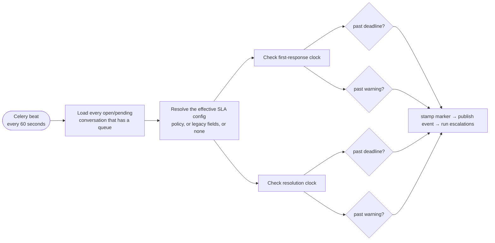
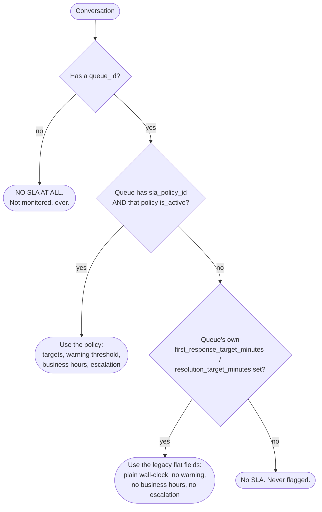

# SLA Engine

**How Blink Engage decides that a conversation is approaching, or past,
its response and resolution targets — and what it does about it.**

Written for an administrator configuring SLA policies (`/sla`), business
hours, holidays and escalation rules, and for anyone trying to explain a
breach after the fact. It describes the system **as it behaves today**.

Companion documents: [queue-architecture.md](queue-architecture.md),
[queue-lifecycle.md](queue-lifecycle.md),
[assignment-logic.md](assignment-logic.md),
[routing-rules.md](routing-rules.md). Original design records:
[sla.md](sla.md) and [queues-routing.md](queues-routing.md) decision #4.

---

## 1. What the SLA engine is

A **background sweep that runs once a minute** and, for every open
conversation that sits in a queue, asks two questions:

1. Has enough time passed that we should *warn* somebody?
2. Has enough time passed that this has *breached*?

When the answer is yes it stamps a timestamp on the conversation,
publishes an event, and runs whatever escalation rules the policy
defines. That is the whole engine.

It is **detection and reaction, not prevention**. Nothing about the SLA
engine makes a conversation get answered faster; it only makes lateness
visible and, if you configure it to, moves the conversation or notifies
someone.



---

## 2. Which configuration applies

Every conversation resolves to exactly one **effective SLA config**,
chosen in this order:



Three things follow, and all three catch people out:

**A conversation with no queue has no SLA whatsoever.** The sweep joins
conversations to queues; a conversation that never matched a routing rule
is invisible to it. It cannot breach, cannot warn, and appears in no SLA
report. See [routing-rules.md](routing-rules.md) §6.

**Deactivating a policy does not disable SLA — it silently reverts the
queue to its legacy flat fields.** Setting `is_active = false` on a
policy makes every queue using it fall back to
`first_response_target_minutes`/`resolution_target_minutes`. If those are
still set from before the policy was assigned, the *old* wall-clock
targets quietly come back. If they are null, SLA disappears entirely. Neither
outcome is announced anywhere.

**A queue's flat fields are not cleared when a policy is assigned.** They
sit there, ignored, as a live fallback. The Queues screen's helper text
says they are ignored while a policy is assigned, which is true — right
up until the policy is deactivated.

---

## 3. The two clocks

| Clock | Starts at | Stops when | Target field |
|---|---|---|---|
| **First response** | `conversation.created_at` — the instant the first inbound message was persisted | `first_response_at` is set: the first time **any** outbound message is successfully sent on the conversation | `first_response_target_minutes` |
| **Resolution** | `conversation.created_at` — the same instant | The conversation leaves `open`/`pending`, i.e. reaches `resolved` or `closed` | `resolution_target_minutes` |

Both clocks start at the same moment, and both measure from the
conversation's creation — **not** from `queue_entered_at`, not from the
most recent customer message, and not from when it was assigned.

Notes that matter:

- **A failed send does not stop the first-response clock.** If the
  channel provider rejects the message, the outbound message row is
  persisted with status `failed` and `first_response_at` is left unset.
  The clock keeps running, correctly.
- **An AI Autopilot reply does stop it.** Autopilot sends through the
  same path as a human, so it sets `first_response_at` exactly as a human
  reply would.
- **An internal note does not stop it.** Only a real outbound message
  to the customer counts.
- Either target may be null. A policy with only a first-response target
  never evaluates resolution, and vice versa.

---

## 4. The SLA clock is never paused

Stated as its own section because it is the most common assumption about
SLA systems, and it is **not true here**.

There is no pause, no hold, no "waiting on customer" stop-the-clock, and
no resume. Specifically:

- **`pending` does not pause anything.** Both `open` and `pending`
  conversations are swept identically. Marking a conversation "pending"
  because you are waiting on the customer does not stop the resolution
  clock.
- **Business hours are not a pause mechanism** in the ordinary sense —
  they are baked into the deadline calculation up front (§5), and only
  for a business-hours-aware policy.
- **Transfers, releases and queue moves do not pause or restart
  anything.** They reset `queue_entered_at` (the *queue wait* clock, used
  by dashboard metrics), which is a different thing entirely.
- **There is no API, no field and no UI to suspend a conversation's
  SLA.**

The only way a clock stops is by being satisfied: a reply for
first-response, a terminal status for resolution.

### And once a marker is set, it is permanent

`sla_first_response_breached_at`, `sla_resolution_breached_at`,
`sla_first_response_warned_at` and `sla_resolution_warned_at` are written
once and **never cleared by anything**. Neither is `first_response_at`.

The important consequence: **a reopened conversation has no meaningful
SLA.** A conversation that was resolved and then reopened by a new
customer message keeps its `first_response_at` (so the first-response
check skips it forever) and keeps any breach markers (so those breach
types can never fire again). The customer's new question is not covered
by any first-response target at all.

---

## 5. Business-hours deadlines

Only a policy with `business_hours_aware = true` consults the company's
Business Hours and Holidays. Everything else — legacy flat fields, and
policies with the flag off — uses plain wall-clock arithmetic:
`created_at + target minutes`.

For a business-hours-aware policy, the deadline is computed by spending
`target` minutes of *open* time:

- Closed weekdays are skipped entirely.
- Holidays are skipped entirely (fixed dates, and month/day pairs for
  holidays flagged as recurring annually).
- Time outside the day's open/close window is skipped.
- A start time that is **before** a day's opening is clipped forward to
  that opening before any minutes are spent.
- The closing time is **exclusive**: 17:00 is already closed.
- The calculation is done in the company's configured timezone.

### Worked example 1 — inside business hours

```
Company business hours : Mon-Fri 09:00-17:00 UTC, Sat/Sun closed
Policy                 : first response 15 minutes, business_hours_aware,
                         warning threshold 80%
Message arrives        : Friday 09:58
```

09:58 is inside Friday's window, so 15 open minutes are available
immediately:

```
Warning at   09:58 + 12 minutes  = Friday 10:10      (80% of 15, floored)
Deadline at  09:58 + 15 minutes  = Friday 10:13
```

Identical to what a plain wall-clock policy would produce. Business hours
only start to matter when a target crosses a boundary.

### Worked example 2 — the answer that surprises people

Same company, same policy. **The message arrives at 16:58 on Friday** —
two minutes before close.

```
Friday   16:58 → 17:00     2 open minutes spent, 13 remaining
Saturday                   closed, skipped
Sunday                     closed, skipped
Monday   00:00 → 09:00     clipped forward to opening
Monday   09:00 → 09:13     13 remaining minutes spent

Warning at   Monday 09:10
Deadline at  Monday 09:13
```

A 15-minute target has become a deadline **64 hours and 15 minutes** of
wall-clock time later. That is exactly what "15 minutes of business time"
means, and it is correct — but if you expected a weekend alarm, you will
not get one.

Now change **one** thing: the same queue has **no SLA policy assigned**
and just uses `first_response_target_minutes = 15`. The deadline is
**Friday 17:13** — thirteen minutes after everyone went home — and it
will breach overnight with nobody there to act on it, weekend or not.

### Worked example 3 — a start outside hours, and a holiday

```
Message arrives : Saturday 12:00
Policy          : first response 60 minutes, business_hours_aware
```

Saturday and Sunday are closed, so the cursor lands on Monday 00:00 and
is clipped forward to Monday 09:00. Sixty open minutes are then available
that morning:

```
Deadline = Monday 10:00
```

If Monday is registered as a Holiday, Monday is skipped in its entirety
and the deadline becomes **Tuesday 10:00**.

### The setting that does nothing on its own

**Turning on Business Hours in Company Settings changes no SLA behaviour
by itself.** It is consulted only by policies with
`business_hours_aware = true`, and only for queues that have such a
policy assigned and active. A queue running on its legacy flat fields is
completely unaffected — this is covered by an explicit regression test in
the repository (`test_legacy_queue_without_a_policy_is_unaffected_by_business_hours`).

---

## 6. Warning thresholds

A policy's `warning_threshold_percent` (1–100, default 80) produces a
second, earlier deadline:

```
warning_minutes = target_minutes × threshold_percent ÷ 100    (integer division, floored)
```

computed with the same business-hours arithmetic as the real deadline.

| Target | Threshold | Warning fires after |
|---|---|---|
| 15 min | 80% | 12 minutes |
| 60 min | 80% | 48 minutes |
| 45 min | 90% | **40** minutes (40.5 floored) |
| 1 min | 80% | **0** minutes — warns on the very first sweep |
| 480 min | 50% | 240 minutes |

Warnings fire **at most once per conversation per clock**, guarded by
`sla_first_response_warned_at` / `sla_resolution_warned_at`.

**A warning is not guaranteed.** It is only published if a sweep happens
to run while the conversation is past the warning point and still short
of the deadline. If the first sweep to see the conversation finds it
already past the deadline — because the worker was down, because the
target is very short, or because the threshold rounds to zero — it
breaches with no warning ever emitted. Once breached, the warning branch
is not reached at all.

**A queue on legacy flat fields has no warning concept whatsoever.**
Warnings exist only for policy-driven queues.

---

## 7. Breach, and what happens next

When a deadline passes, in one sweep, in this order:

1. The breach timestamp is stamped on the conversation.
2. `conversation.sla_breached` is published, carrying `conversation_id`,
   `queue_id` and `breach_type` (`first_response` or `resolution`).
3. Every escalation rule on the policy whose `trigger` is `breach` runs.

Warnings do the same with `conversation.sla_warning` (which additionally
carries `warning_threshold_percent`) and `trigger: warning` rules.

Both events are published **exactly once per conversation per breach
type**, guarded by the timestamp markers, so re-running the sweep — or
running several workers — never duplicates them.

### Escalation actions

Configured per policy as a list of `{trigger, action, …}` entries.

| Action | What it does | Required parameter |
|---|---|---|
| `notify` | Creates an in-app notification of type `sla_escalation` for each listed user | `user_ids` (explicit user ids only) |
| `reassign_queue` | Moves the conversation to another queue | `target_queue_id` |
| `reassign_agent` | Sets the conversation's assignee | `target_agent_id` |

Behaviours worth knowing:

- **`reassign_queue` does not unassign the current agent.** It moves
  `queue_id` and resets `queue_entered_at`, but leaves
  `assigned_agent_id` exactly as it was. A conversation escalated from
  Tier 1 to Tier 2 is still assigned to the Tier 1 agent who was already
  too slow.
- **`reassign_queue` does not re-run auto-assignment** in the target
  queue, whatever that queue's strategy is.
- **`reassign_agent` does not validate the agent.** It goes through the
  same unvalidated path described in
  [assignment-logic.md](assignment-logic.md) §6.
- **Escalation does not stop the clock.** Moving a breached conversation
  elsewhere does not reset or re-arm anything; the breach marker is
  already permanent.
- **The clock still runs from the original `created_at`** under the new
  queue's policy. If the destination queue has a shorter resolution
  target, the conversation may breach resolution immediately on the next
  sweep.
- **A failing rule is logged and skipped.** A rule pointing at a deleted
  agent or another company's queue fails, is caught, and the sweep
  continues for every other conversation. Nothing surfaces the failure to
  an administrator.
- **No escalation for legacy queues.** Flat-field queues publish
  `conversation.sla_breached` and nothing else happens.
- **There is no "notify this queue's supervisor" primitive.** No
  supervisor or manager field exists on a queue or department, so
  `notify` must list named people, and those lists go stale silently.

### SLA events can also trigger AI

If the company has enabled the Autopilot SLA activation mode, a warning
or breach can cause AI to answer rather than waiting longer for a human.
This is a company-wide opt-in and does **not** require the queue's
`autopilot_enabled` flag. Escalation rules still run — an AI reply and a
`notify` escalation are independent responses to the same event. See
[sla.md](sla.md) § "SLA events also drive AI Autopilot" and
[ai-engine.md](ai-engine.md).

---

## 8. The sweep itself

- Scheduled by Celery beat as `blinkengage.queues.check_sla_breaches`,
  **every 60 seconds**.
- Runs across **every company** in one pass.
- Loads **every** non-deleted `open`/`pending` conversation joined to a
  queue, then evaluates the deadlines in Python. There is no deadline
  filter in the query, no company filter, no target filter and no limit
  — a company with a large open backlog is walked in full, once a minute.
- The company's business-hours schedule and holidays are resolved once
  per company per sweep and cached for that run.
- Safe to run concurrently and safe to re-run; the timestamp markers make
  every action idempotent.
- **The sweep does not check whether the queue is active or deleted.**
  Conversations sitting in a deactivated — or soft-deleted — queue are
  swept, breached and escalated exactly like any other, even though the
  queue no longer appears anywhere in the UI.
- There is no API to trigger the sweep, and no UI showing when it last
  ran. Its only visible outputs are the timestamps on conversations, the
  events, the notifications, and the SLA report.

---

## 9. Previewing a policy

`POST /sla-policies/preview` takes a policy id and a hypothetical start
time and returns four timestamps: first-response warning and deadline,
resolution warning and deadline. It uses the same business-hours
arithmetic as the sweep, so for an **active policy** the preview is what
would really happen.

Two limits:

- **The preview ignores `is_active`.** Previewing a deactivated policy
  shows you its own business-hours math, while a real conversation on a
  queue holding that policy would fall back to the queue's legacy flat
  fields (§2). The preview is truthful about the policy and misleading
  about the queue.
- **You preview a policy, not a queue.** There is no way to ask "what are
  this queue's real deadlines right now", which is the question an
  administrator with a mix of policy-driven and legacy queues actually
  has.

---

## 10. What the SLA engine does not do

- **No pausing, no stop-the-clock, no business-hours "hold"** (§4).
- **No SLA for a conversation without a queue** (§2).
- **No SLA per channel, per customer, per priority or per tag.** SLA is
  a property of a queue and nothing else. `Conversation.priority` is
  explicitly independent — an `urgent` conversation gets the same targets
  as a `low` one.
- **No per-queue business hours.** Business hours are company-wide.
- **No re-arming on reopen** (§4).
- **No first-response clock per customer message.** Only the very first
  reply on the conversation counts, ever; a customer who asks a second
  question and waits three days triggers nothing.
- **No countdown anywhere in the product.** The deadlines are computed
  only inside the sweep and are never stored, never returned by the
  conversation API, and never rendered on the Inbox or the conversation
  view. An agent cannot see how long they have left. The only
  SLA-related fields on a conversation are the four *after-the-fact*
  timestamps.
- **No way to clear `Queue.sla_policy_id`** back to unset — you can only
  reassign it to a different policy.
- **No editing of holidays** — create and delete only.
- **No warning if a queue has no SLA at all**, and no report of which
  queues are unmonitored.
- **No record of why.** `conversation.sla_breached` carries the
  conversation, the queue and the breach type. It does not carry the
  target that was missed, the deadline that was computed, which policy
  applied, whether business hours were used, or whether a warning was
  issued first. Reading a breached conversation's row tells you *that* it
  breached and *when it was noticed* — not what it was measured against.
  **The system today cannot answer "why did this breach".** This is the
  gap the explainability milestone exists to close.

---

## 11. Where to look next

| Question | Document |
|---|---|
| Why is this conversation in this queue (or in none)? | [routing-rules.md](routing-rules.md) |
| What SLA fields does a queue have? | [queue-architecture.md](queue-architecture.md) §2 |
| Which timestamp means what? | [queue-lifecycle.md](queue-lifecycle.md) §3 |
| Why did an escalation reassign it? | §7 above, then [assignment-logic.md](assignment-logic.md) |
| Why did AI answer instead of a person? | [ai-engine.md](ai-engine.md) |
| Historical SLA reporting | [reports-analytics.md](reports-analytics.md) |
| Original design rationale | [sla.md](sla.md) |

---

## 12. Known discrepancies with existing documentation

Recorded, not resolved. The **code** is what happens.

1. **The sweep is not "one indexed query".** `queues-routing.md`
   decision #4 describes it as "a single periodic sweep … querying open/
   pending conversations **whose queue has a target and whose deadline
   has passed** … O(one indexed query) regardless of conversation
   count". The implementation selects **every** non-deleted open/pending
   conversation that has a queue, for **every company**, with no
   deadline predicate, no target predicate and no limit, and evaluates
   each in Python. The idempotency and correctness claims in that
   decision hold; the cost claim does not.

2. **A deactivated policy is not documented as falling back.**
   `sla.md` describes the legacy flat fields as the fallback "for a queue
   with no `sla_policy_id` assigned". `_EffectivePolicy` also falls back
   whenever the assigned policy has `is_active = false`, silently
   restoring the queue's old wall-clock targets (or removing SLA
   entirely). Neither the document nor the UI mentions this.

3. **"What an admin previews is exactly what would happen in
   production" is conditional.** `sla.md` § "Preview" states this without
   qualification. The preview ignores `policy.is_active` and has no
   notion of which queue the policy is attached to, so it diverges from
   reality for a deactivated policy (§9).

4. **Nothing documents that the sweep ignores queue state.** Neither
   document says that conversations in an inactive or soft-deleted queue
   are still monitored, breached and escalated.

5. **Nothing documents the permanence of the markers on reopen.** Both
   documents describe the `*_breached_at`/`*_warned_at` columns as
   idempotency markers, which they are, without stating the operational
   consequence: a reopened conversation is effectively outside SLA
   forever (§4).

6. **`reassign_queue`'s effect on assignment is undocumented.**
   `sla.md` § "Escalation" says the two reassign actions "call
   `ConversationService.update()`". Because that method treats `None` as
   "leave unchanged", `reassign_queue` moves the conversation while
   leaving the existing agent assigned to it.
